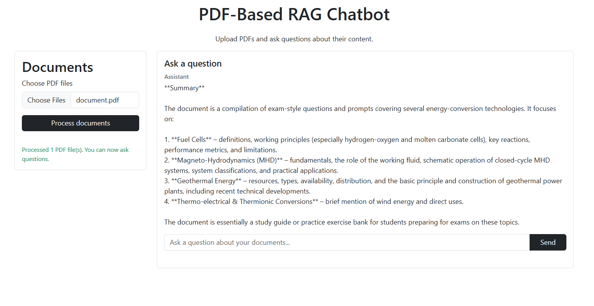

# PDF-Based RAG Application
A Retrieval-Augmented Generation (RAG) application for uploading PDF documents and asking questions about their content. The application extracts and chunks PDF text, finds relevant passages with vector search, and uses Groq to generate context-aware answers.



## Features
- Upload and process one or more PDF files.
- Extract and split document text for retrieval.
- Generate embeddings with Hugging Face and index them with FAISS.
- Ask questions in a conversational interface powered by Groq.
- Use a lightweight Flask backend and a Bootstrap-based light-theme web interface.

## Requirements
- Python 3.10 or newer
- A Groq API key

## Setup Installation
```
python -m venv .venv
.\.venv\Scripts\Activate.ps1
python -m pip install -r requirements.txt
$env:GROQ_API_KEY="your_groq_api_key_here"
python app.py
```

## Working
1. Upload PDF documents through the web interface.
2. Extract text and divide it into overlapping chunks.
3. Embed the chunks and store them in a FAISS vector index.
4. Retrieve relevant chunks for each question.
5. Send the question and retrieved context to Groq and display the answer.
